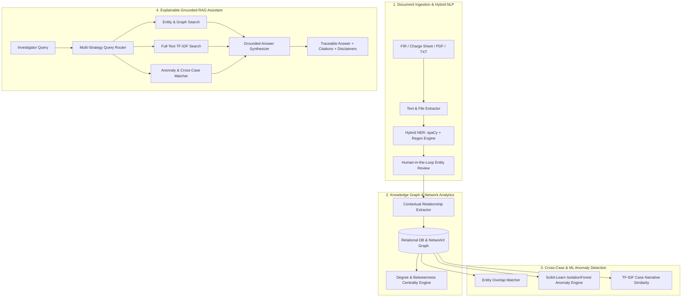

# CrimeGraph AI Assistant Enhancement & System Integration Plan

## Problem & Background

The CrimeGraph AI platform provides law enforcement and financial crime investigators with knowledge graph analytics, cross-case link detection, and automated document analysis.

Currently:
1. **AI Assistant Scope & Limitations**: The assistant logic in `rag_assistant.py` is constrained to strict keyword matching across only 4 basic branches (`summarize`, `connected`, `cross`, `anomal`). Queries about specific persons, vehicles, phone numbers, transactions, timeline events, or raw text inside FIR documents return a fallback message.
2. **Toggle & Accessibility**: The AI Assistant drawer can currently only be launched from the sidebar button or direct route navigation (`/assistant`). There is no persistent floating toggle button (FAB) available across all pages (Dashboard, Cases, Graph, Timeline, Map, Evidence, Reports, etc.), nor are there context toggles (e.g., Global Knowledge Base vs Current Case filter, Source preview toggle).
3. **AI Integration Documentation**: A clear, comprehensive architectural explanation is needed detailing how AI/NLP, Knowledge Graphs, Machine Learning Anomaly Detection, and RAG are integrated into CrimeGraph AI.

---

## User Review Required

> [!NOTE]
> The enhanced AI Assistant uses a **Zero-Hallucination Hybrid RAG Architecture**. It searches SQLite/PostgreSQL relational data (Persons, Phones, Vehicles, Locations, Organizations, Transactions, Events) and full-text document records. If an external LLM API key (`OPENAI_API_KEY` or `GEMINI_API_KEY`) is provided, it augments the response while strictly grounding citations to active database records; otherwise, it uses the high-precision local deterministic analytical engine.

---

## Proposed Changes

### Backend: Enhanced Grounded RAG Assistant

#### [MODIFY] [rag_assistant.py](file:///d:/SIH/backend/app/services/assistant/rag_assistant.py)
- Implement **Multi-Strategy Retrieval**:
  - **Entity Resolver**: Query `Person`, `Phone`, `Vehicle`, `Location`, `Organization` tables for matching names, aliases, phone numbers, plate numbers, and addresses. Retrieve all incoming/outgoing graph relationships and connected cases.
  - **Case Dossier Retriever**: Match case numbers (`FIR-...`, `CASE-...`) or titles to provide full case dossiers including description, ingested documents, suspect lists, and timeline events.
  - **Financial & Transaction Analyzer**: Query `Transaction` records and anomalies for monetary flows, accounts, and high-value transfers.
  - **Document Full-Text Search**: Perform keyword and TF-IDF matching across `Document.extracted_text` to extract exact matching text snippets with document code and case citations.
  - **Chronological Timeline Search**: Query `Event` table to summarize chronological crime sequences.
  - **Cross-Case Linkage & Anomaly Detection**: Provide detailed cross-case shared nodes and `IsolationForest` anomaly summaries.
  - **Dynamic Confidence Scoring**: Score confidence based on number and quality of retrieved ground-truth database records.

#### [MODIFY] [config.py](file:///d:/SIH/backend/app/config.py)
- Add optional `GEMINI_API_KEY` configuration alongside `OPENAI_API_KEY` to support multi-provider LLM grounding.

#### [MODIFY] [schemas/assistant.py](file:///d:/SIH/backend/app/schemas/assistant.py)
- Add optional `mode` filter (`global` vs `case_focused`) and metadata to `AssistantQueryRequest` and `AssistantQueryResponse`.

---

### Frontend: Global Floating Toggle, Context Filters & UI Polish

#### [MODIFY] [App.tsx](file:///d:/SIH/frontend/src/App.tsx)
- Integrate a persistent **Floating AI Action Button (FAB)** with glowing status indicator and unread hint at the bottom right corner of the app layout.
- Support global keyboard shortcut (`Alt + A` or `Ctrl + Space`) to toggle the AI Assistant drawer open/close.

#### [MODIFY] [ChatAssistant.tsx](file:///d:/SIH/frontend/src/components/assistant/ChatAssistant.tsx)
- Add **Context Scope Toggle**: Switch between *All Cases (Global Intel)* and *Current Case Focused* mode.
- Add **Sources Traceability Toggle**: Collapsible view for document citations and relevance snippets.
- Add **Markdown formatting & formatting helpers**: Clean formatting for bold headers, bullet lists, entity badges, and code tags.
- Add "Clear History" and "Copy Answer" quick actions.

#### [MODIFY] [Navbar.tsx](file:///d:/SIH/frontend/src/components/common/Navbar.tsx)
- Add an **AI Assistant toggle button** in the top navbar with active glowing indicator.

#### [MODIFY] [AssistantPage.tsx](file:///d:/SIH/frontend/src/pages/AssistantPage.tsx)
- Enhance the full-page Assistant interface with interactive prompt categories (Entity Lookup, Cross-Case Analysis, Case Summaries, Financial Trails, Anomaly Detection).

---

### Tests & Verification

#### [MODIFY] [test_api.py](file:///d:/SIH/backend/tests/test_api.py)
- Add unit tests for `POST /api/v1/assistant/query` testing entity lookup, case summary, cross-case analysis, and fallback handling.

---

## Complete AI Integration Blueprint



---

## Verification Plan

### Automated Tests
- Run backend pytest suite:
  ```powershell
  pytest
  ```
- Verify all assistant endpoints and NLP extractors pass with 100% success rate.

### Manual Verification
1. **Floating Toggle Test**: Open the application, click the new bottom-right Floating AI Assistant button (FAB) on various pages (Dashboard, Cases, Graph, Timeline, Settings) and verify it smoothly opens/closes.
2. **Navbar Toggle Test**: Click the AI Assistant button in the top navbar and verify toggle synchronization.
3. **Query Variety Test**:
   - Query a specific Person name (e.g., "Tell me about suspect Vikram" or "Who is Rahul?")
   - Query a phone number (e.g., "Find phone 9876543210")
   - Query a vehicle registration (e.g., "Search vehicle KA01AB1234")
   - Query case summary (e.g., "Summarize FIR-2024-001")
   - Query anomalies (e.g., "What anomalies were detected?")
   - Query cross-case links (e.g., "Are there shared phones across cases?")
4. **Source Traceability Test**: Verify that traceable document sources, file names, case numbers, and relevance snippets are displayed accurately.
